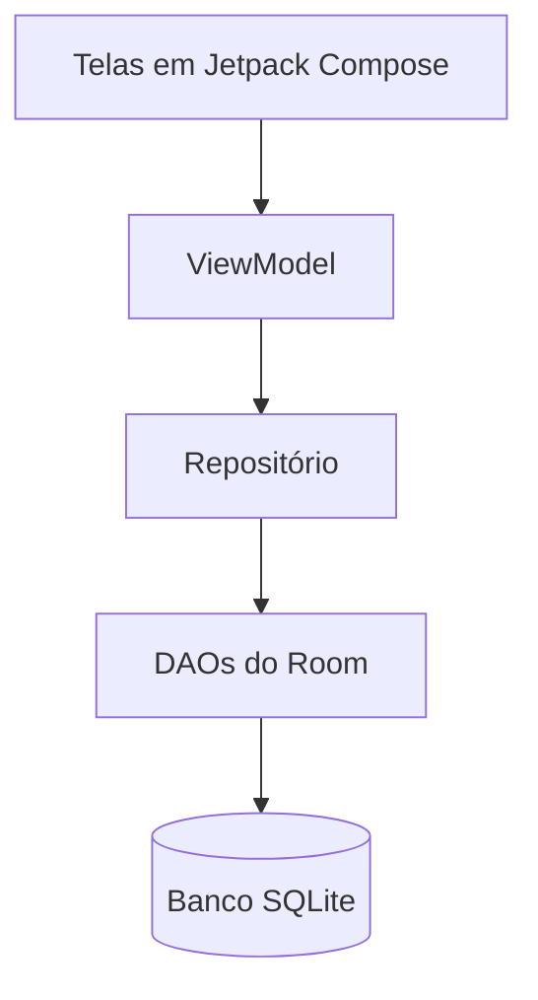
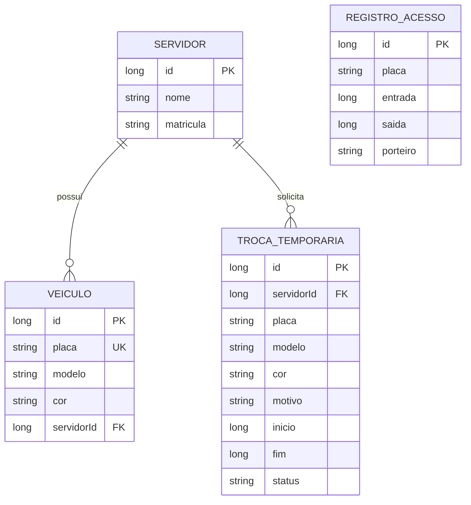

# Modelo de Arquitetura

**SPG - SmartPark Guarita**
Versão 1.0. Descreve o que está implementado em `SmartParkGuarita/`.

## 1. Visão geral

Aplicativo Android nativo, em Kotlin, com interface em Jetpack Compose e persistência local em Room (SQLite). Não há servidor: todos os dados e os quatro perfis ficam no mesmo aparelho, o tablet da portaria. O perfil é escolhido na tela inicial, sem login.



| Camada | Responsabilidade |
|---|---|
| Tela (Compose) | Mostra os dados e valida o que o usuário digita |
| ViewModel | Guarda o estado da tela, chama o repositório e devolve avisos de sucesso ou erro |
| Repositório | Aplica as regras de negócio e fala com os DAOs |
| DAO e banco (Room) | Consultas, inserções, atualizações e exclusões |

## 2. Tecnologias

| Item | Versão |
|---|---|
| Kotlin | 2.2.10 |
| Android Gradle Plugin | 9.5.2 |
| Jetpack Compose (BOM) | 2026.02.01, com Material 3 |
| Room, com KSP | 2.8.5, KSP 2.3.14 |
| Navigation Compose | 2.10.2 |
| Lifecycle (ViewModel) | 2.11.1 |
| SDK mínimo | API 26 (Android 8.0) |

## 3. Estrutura do código

```
app/src/main/java/com/example/smartparkguarita
├── MainActivity.kt
├── SmartParkApplication.kt      cria o banco e o repositório
├── domain
│   └── Dominio.kt               enums, validação de placa, resultados
├── data
│   ├── AppDatabase.kt
│   ├── SmartParkRepository.kt   regras de negócio
│   ├── dao/Daos.kt
│   └── entity/Entidades.kt
├── viewmodel
│   ├── PorteiroViewModel.kt
│   ├── AdminViewModel.kt
│   ├── ServidorViewModel.kt
│   ├── PainelViewModel.kt
│   ├── AppViewModelProvider.kt
│   └── Aviso.kt
└── ui
    ├── SmartParkNavHost.kt      navegação
    ├── TelaBase.kt, Componentes.kt
    ├── PerfilScreen.kt, PorteiroScreen.kt, PresentesScreen.kt
    ├── AdminScreens.kt, ServidorScreens.kt, PainelScreen.kt
    └── theme
```

## 4. Modelo de dados



| Entidade | Observações |
|---|---|
| Servidor | Excluir um servidor exclui seus veículos e suas trocas (exclusão em cascata) |
| Veículo | A placa é única |
| TrocaTemporaria | `status` é PENDENTE, APROVADA ou RECUSADA. `inicio` e `fim` são instantes em milissegundos |
| RegistroAcesso | Guarda a placa, não o veículo, para registrar também os que entram por troca temporária. `saida` é nula enquanto o veículo está dentro |

Enums em `domain/Dominio.kt`: `Perfil`, `StatusSolicitacao`, `Turno` e `Duracao` (Hoje, 3 dias ou 7 dias, sempre até 23h59).

## 5. Regras de negócio

**Consulta de placa** (`consultarPlaca`):

1. Placa inválida (fora do formato ABC1234 ou ABC1D23): PLACA INVÁLIDA.
2. Existe troca APROVADA com a hora atual entre `inicio` e `fim`: AUTORIZADO por troca temporária, com a validade.
3. Senão, existe veículo cadastrado com a placa: AUTORIZADO.
4. Senão: NÃO AUTORIZADO.

**Entrada:** só se a placa está autorizada e não há registro em aberto (`saida` nula) para ela.

**Saída:** só se há registro em aberto para a placa.

**Ocupação:** quantidade de registros com `saida` nula.

**Movimento por turno:** entradas e saídas agrupadas pelo turno da hora do registro. Os horários dos turnos (manhã 6h a 12h, tarde 12h a 18h, noite 18h a 6h) são provisórios, até a resposta da pergunta 11 da entrevista.

**Trocas temporárias:** o administrador cadastra já aprovada; o servidor solicita e ela nasce PENDENTE; só o administrador aprova ou recusa, e uma solicitação já decidida não pode ser decidida de novo.

**Validação:** placa válida, campos obrigatórios preenchidos e fim da validade não anterior ao início.

Na primeira execução o app cria dados fictícios (dois servidores, dois veículos e uma troca temporária de exemplo) para testes e demonstração.

## 6. Conceitos da disciplina e onde aparecem

| Conceito | Onde |
|---|---|
| Strings | Validação e normalização da placa (`Placa`) |
| Coleções | Listas de veículos, solicitações e presentes; agrupamento por turno em `movimentoPorTurno` |
| Funções | Regras do repositório e funções de validação |
| Orientação a objetos | Entidades, enums, interfaces seladas de resultado, ViewModels |
| Tratamento de exceções | Placa repetida (`SQLiteConstraintException`) e resultados de erro nas operações |
| Validação de formulários | Cadastros e solicitações, com mensagens de erro nos diálogos |
| Persistência | Room, com DAOs e `AppDatabase` |

## 7. Testes

Testes unitários em `app/src/test`: validação de placa, turnos e validade das trocas (11 testes). Para rodar, use `./gradlew :app:testDebugUnitTest` dentro de `SmartParkGuarita/`. Os testes de aceitação de cada história estão em `Historias_de_Usuario.md`.
