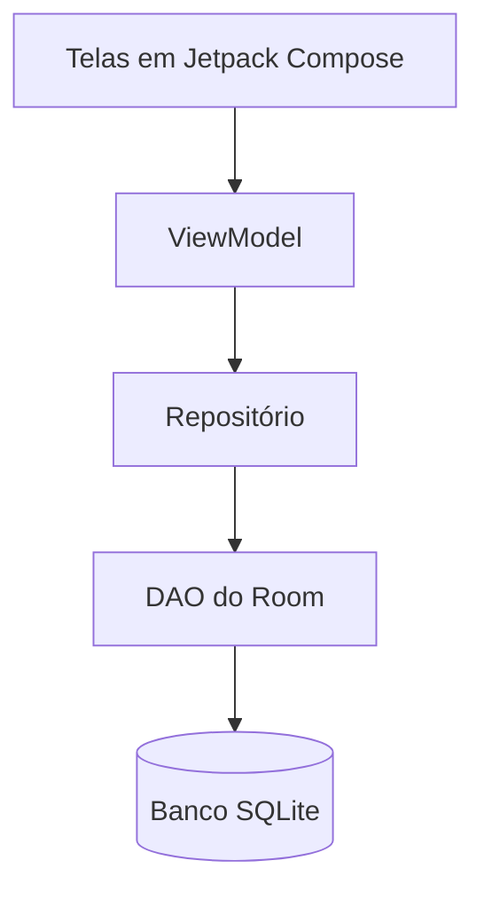
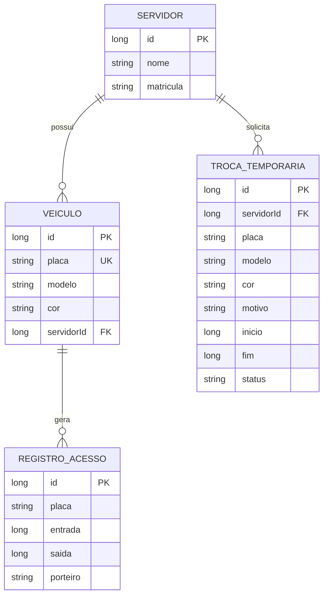

# Modelo de Arquitetura

**SPG - SmartPark Guarita**
Versão 0.1: proposta inicial para a equipe validar. Pode mudar depois da entrevista e da escolha do caso de uso usado para testar a arquitetura (US01).

## 1. Visão geral

Aplicativo Android nativo, em Kotlin, com interface em Jetpack Compose e persistência local em Room (SQLite). Não há servidor: todos os dados ficam no aparelho.



| Camada | Responsabilidade |
|---|---|
| Tela (Compose) | Mostra os dados, recebe os toques e a digitação, valida os formulários |
| ViewModel | Guarda o estado da tela, chama o repositório e expõe o resultado à tela |
| Repositório | Aplica as regras de negócio (por exemplo, quando uma placa está autorizada) e fala com os DAOs |
| DAO / Room | Acesso ao banco: consultas, inserções, atualizações e exclusões |

## 2. Estrutura sugerida de pacotes

```
com.exemplo.smartparkguarita
├── ui
│   ├── perfil          (seleção de perfil)
│   ├── porteiro        (consultar placa, saída, presentes)
│   ├── admin           (servidores, veículos, trocas, solicitações)
│   ├── servidor        (nova solicitação, minhas solicitações)
│   └── painel          (ocupação e turnos)
├── viewmodel
├── repository
├── data
│   ├── entity
│   ├── dao
│   └── AppDatabase
└── domain              (enums, regras e resultados, como ResultadoConsulta)
```

O nome do pacote é provisório e será definido ao criar o projeto no Android Studio.

## 3. Modelo de dados (Room)



| Entidade | Observações |
|---|---|
| Servidor | Campos mínimos. Outros dados (cargo, telefone) dependem da resposta 6 |
| Veículo | A placa é única. Outros dados (ano) dependem da resposta 7 |
| TrocaTemporaria | `status` é PENDENTE, APROVADA ou RECUSADA. `inicio` e `fim` guardam data e hora (milissegundos) |
| RegistroAcesso | `saida` é nula enquanto o veículo está dentro. O turno é calculado a partir da hora de entrada |

**Enums:** `Perfil` (PORTEIRO, ADMINISTRADOR, SERVIDOR), `StatusSolicitacao` (PENDENTE, APROVADA, RECUSADA), `Turno` (MANHA, TARDE, NOITE, com horários a confirmar na pergunta 11).

## 4. Regras principais

**Consulta de placa** (`ResultadoConsulta`):

1. Se existe `TrocaTemporaria` com status APROVADA e a hora atual entre `inicio` e `fim`, o resultado é AUTORIZADO_TROCA (com a validade).
2. Senão, se existe `Veiculo` com a placa, o resultado é AUTORIZADO (com o servidor).
3. Senão, o resultado é NAO_AUTORIZADO.

**Entrada:** só se a placa está autorizada e não há `RegistroAcesso` com `saida` nula para ela.

**Saída:** só se há `RegistroAcesso` com `saida` nula para a placa.

**Ocupação:** quantidade de `RegistroAcesso` com `saida` nula.

**Movimento por turno:** contagem de entradas e saídas agrupadas pelo turno da hora do registro.

## 5. Conceitos da disciplina e onde aparecem

| Conceito | Onde |
|---|---|
| Strings | Validação e formatação da placa |
| Coleções | Listas de veículos presentes, solicitações e agrupamento por turno |
| Funções | Regras no repositório e funções de validação |
| Orientação a objetos | Entidades, enums e classes de resultado |
| Tratamento de exceções | Falhas de banco e entradas inválidas |
| Validação de formulários | Cadastros e solicitações em Compose |
| Persistência | Room, com DAOs e `AppDatabase` |

## 6. Caso de uso escolhido para testar a arquitetura

Sugestão: **US01, Consultar placa**. Ela percorre todas as camadas (tela, ViewModel, repositório e Room) e depende das entidades Veículo e TrocaTemporaria. Implementada e testada, valida a arquitetura antes das demais histórias.
