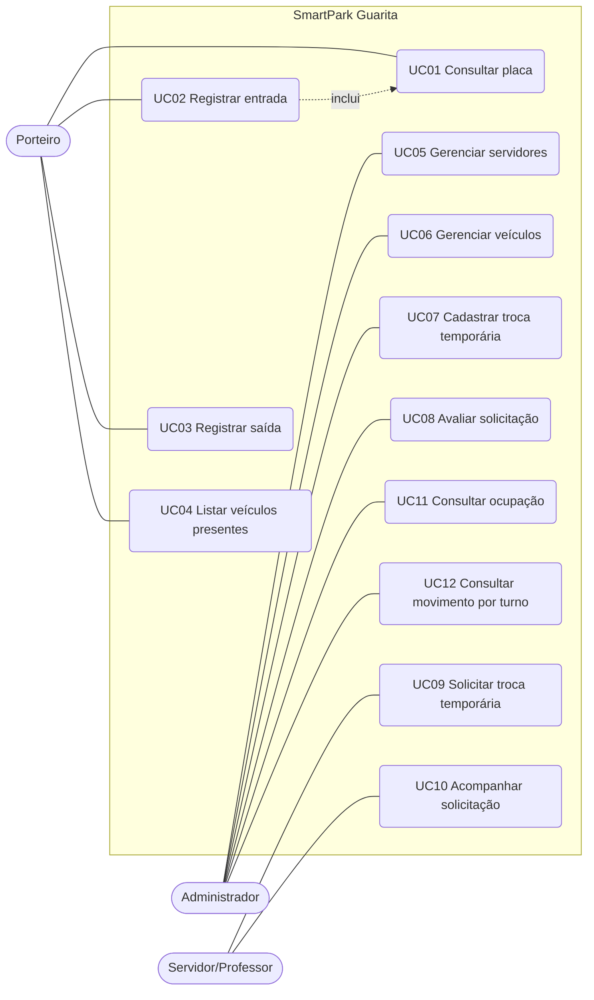

# Modelo de Casos de Uso

**SPG - SmartPark Guarita**
Versão 0.1 (rascunho, a revisar depois da entrevista com o cliente)

## 1. Atores

| Ator | Descrição |
|---|---|
| Porteiro | Trabalha na guarita, consulta placas e registra entradas e saídas |
| Administrador | Mantém os cadastros, as trocas temporárias e avalia solicitações; acompanha o painel |
| Servidor/Professor | Solicita trocas temporárias e acompanha os próprios pedidos |

O perfil Painel é uma tela de consulta usada pelo Administrador (casos de uso UC11 e UC12).

## 2. Diagrama

## 3. Lista de casos de uso

| Caso de uso | Ator | História de usuário | Resumo |
|---|---|---|---|
| UC01 Consultar placa | Porteiro | US01 | Digita a placa e vê se o veículo está autorizado |
| UC02 Registrar entrada | Porteiro | US02 | Registra a entrada de um veículo autorizado |
| UC03 Registrar saída | Porteiro | US03 | Registra a saída de um veículo que está dentro |
| UC04 Listar veículos presentes | Porteiro | US04 | Mostra os veículos que entraram e ainda não saíram |
| UC05 Gerenciar servidores | Administrador | US05 | Cadastra, edita e exclui servidores |
| UC06 Gerenciar veículos | Administrador | US06 | Cadastra, edita e exclui veículos de um servidor |
| UC07 Cadastrar troca temporária | Administrador | US07 | Autoriza uma placa por um período |
| UC08 Avaliar solicitação | Administrador | US08 | Aprova ou recusa uma solicitação de troca |
| UC09 Solicitar troca temporária | Servidor | US09 | Pede autorização para entrar com outro veículo |
| UC10 Acompanhar solicitação | Servidor | US10 | Vê o status dos próprios pedidos |
| UC11 Consultar ocupação | Administrador | US11 | Vê quantos veículos estão no estacionamento agora |
| UC12 Consultar movimento por turno | Administrador | US12 | Vê entradas e saídas por turno |

## 4. Descrição dos casos de uso principais

### UC01 Consultar placa

- **Ator:** Porteiro
- **Pré-condição:** perfil Porteiro selecionado.
- **Fluxo principal:**
  1. O porteiro digita a placa.
  2. O sistema valida o formato da placa.
  3. O sistema procura uma troca temporária aprovada e dentro da validade para a placa.
  4. Se não houver, o sistema procura a placa entre os veículos cadastrados.
  5. O sistema mostra o resultado: "Autorizado" (com o nome do servidor), "Autorizado por troca temporária, válida até [data e hora]" ou "Não autorizado".
- **Fluxos alternativos:**
  - 2a. Placa em formato inválido: o sistema mostra a mensagem de placa inválida e pede nova digitação.
- **Pós-condição:** nenhuma alteração nos dados.

### UC02 Registrar entrada

- **Ator:** Porteiro
- **Pré-condição:** a placa foi consultada e está autorizada (UC01).
- **Fluxo principal:**
  1. O porteiro confirma a entrada.
  2. O sistema registra a placa, a data, a hora e o porteiro.
  3. O sistema confirma o registro.
- **Fluxos alternativos:**
  - 1a. Veículo não autorizado: o sistema não cria o registro e avisa.
  - 1b. Veículo já está dentro: o sistema avisa que a entrada já foi registrada.
- **Pós-condição:** o veículo passa a constar na lista de presentes.

### UC03 Registrar saída

- **Ator:** Porteiro
- **Fluxo principal:**
  1. O porteiro informa a placa do veículo que está saindo.
  2. O sistema encontra a entrada em aberto e registra a data e a hora da saída.
- **Fluxos alternativos:**
  - 2a. Não há entrada em aberto para a placa: o sistema avisa que não há entrada registrada.
- **Pós-condição:** o veículo sai da lista de presentes.

### UC07 Cadastrar troca temporária

- **Ator:** Administrador
- **Fluxo principal:**
  1. O administrador escolhe o servidor e informa placa, modelo, cor, motivo, início e fim da validade.
  2. O sistema valida o formulário.
  3. O sistema salva a troca como aprovada.
- **Fluxos alternativos:**
  - 2a. Campo obrigatório vazio ou fim anterior ao início: o sistema mostra a mensagem de erro.
- **Pós-condição:** a placa é autorizada pelo período informado e deixa de ser autorizada quando ele termina.

### UC08 Avaliar solicitação

- **Ator:** Administrador
- **Pré-condição:** existe uma solicitação pendente (UC09).
- **Fluxo principal:**
  1. O administrador abre a lista de solicitações pendentes.
  2. Escolhe uma solicitação e a aprova ou recusa.
  3. O sistema atualiza o status e, se aprovada, autoriza a placa no período.
- **Fluxos alternativos:**
  - 2a. Solicitação já decidida: o sistema não permite decidir de novo.

### UC09 Solicitar troca temporária

- **Ator:** Servidor/Professor
- **Fluxo principal:**
  1. O servidor informa placa, modelo, cor, motivo e período.
  2. O sistema valida o formulário.
  3. O sistema cria a solicitação com status "pendente".
- **Fluxos alternativos:**
  - 2a. Campo obrigatório vazio ou período inválido: o sistema mostra a mensagem de erro.

### UC11 e UC12 Consultar ocupação e movimento por turno

- **Ator:** Administrador
- **Fluxo principal:** o administrador abre o painel e vê a ocupação atual e as entradas e saídas agrupadas por turno (manhã, tarde e noite).

## 5. Regras de negócio

| Nº | Regra |
|---|---|
| RN1 | Uma placa está autorizada se houver uma troca temporária aprovada e dentro da validade, ou se pertencer a um veículo cadastrado |
| RN2 | A troca temporária expira sozinha no fim do período, sem alterar o cadastro do veículo habitual |
| RN3 | Só é possível registrar entrada de veículo autorizado e que não esteja dentro |
| RN4 | Só é possível registrar saída de veículo com entrada em aberto |
| RN5 | A placa é única entre os veículos cadastrados |
| RN6 | A solicitação do servidor nasce "pendente" e só o administrador a aprova ou recusa (a confirmar na entrevista) |
| RN7 | O fim da validade de uma troca não pode ser anterior ao início |

As regras RN6 e o comportamento do veículo habitual durante a troca (pergunta 14) dependem das respostas do cliente.
