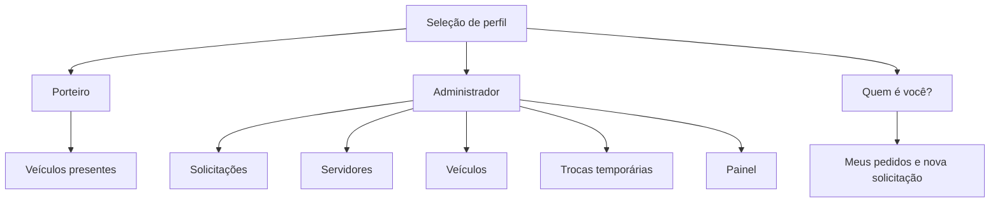

# Protótipo das telas

**SPG - SmartPark Guarita**
Versão 1.0. Desenho das telas como foram implementadas no app. Os dados são fictícios.

Os desenhos são esquemas simples. Para a versão refinada do relatório, use prints do app rodando no tablet.

## 1. Fluxo de navegação



## 2. Seleção de perfil

```
+--------------------------------------+
| SmartPark Guarita                    |
|                                      |
|  Controle do estacionamento do       |
|  câmpus                              |
|                                      |
|  Escolha o seu perfil                |
|  +--------------------------------+  |
|  | Porteiro                       |  |
|  | Consultar placas e registrar   |  |
|  | entradas e saídas              |  |
|  +--------------------------------+  |
|  | Administrador                  |  |
|  +--------------------------------+  |
|  | Servidor/Professor             |  |
|  +--------------------------------+  |
+--------------------------------------+
```

## 3. Porteiro

```
+--------------------------------------+
| < Voltar   Porteiro                  |
|                                      |
|  Placa                               |
|  [ BRA2E19                        ]  |
|  [          Consultar             ]  |
|                                      |
|  +--------------------------------+  |
|  | AUTORIZADO - TROCA TEMPORÁRIA  |  |
|  | Prof. Exemplo Silva. Válida    |  |
|  | até 01/12/2026 23:59           |  |
|  +--------------------------------+  |
|                                      |
|  [      Registrar entrada         ]  |
|  [      Registrar saída           ]  |
|  [  Veículos presentes (3)        ]  |
+--------------------------------------+
```

O cartão de resultado é verde para "Autorizado" e "Autorizado por troca temporária", e vermelho para "Não autorizado" e "Placa inválida". O botão de entrada só fica ativo depois de uma consulta que autorizou o veículo.

Veículos presentes: lista de cartões com a placa, a hora de entrada e o porteiro.

## 4. Administrador

```
+--------------------------------------+
| < Voltar   Administrador             |
|                                      |
|  +--------------------------------+  |
|  | Solicitações        [2 pend.]  |  |
|  | Aprovar ou recusar pedidos     |  |
|  +--------------------------------+  |
|  | Servidores                     |  |
|  +--------------------------------+  |
|  | Veículos                       |  |
|  +--------------------------------+  |
|  | Trocas temporárias             |  |
|  +--------------------------------+  |
|  | Painel                         |  |
|  +--------------------------------+  |
+--------------------------------------+
```

**Servidores e Veículos:** botão "Novo" no topo e uma lista de cartões com Editar e Excluir. O cadastro e a edição abrem em um diálogo; excluir pede confirmação.

```
+--------------------------------------+
| Novo veículo                         |
|  Placa   [                        ]  |
|  Modelo  [                        ]  |
|  Cor     [                        ]  |
|  [ Servidor: Prof. Exemplo Silva  ]  |
|              [Cancelar]   [Salvar]   |
+--------------------------------------+
```

**Trocas temporárias:** lista com a placa, o status em uma etiqueta colorida (pendente em amarelo, aprovada em verde, recusada em vermelho), o servidor, o motivo e o período. O diálogo de nova troca pede servidor, placa, modelo, cor, motivo e a validade: Hoje, 3 dias ou 7 dias.

**Solicitações:** lista das pendentes, cada uma com os botões Recusar e Aprovar.

## 5. Servidor/Professor

```
+--------------------------------------+       +--------------------------------------+
| < Voltar   Quem é você?              |       | < Voltar   Servidor/Professor        |
|                                      |       |                                      |
|  +--------------------------------+  |       |  Olá, Prof. Exemplo Silva            |
|  | Prof. Exemplo Silva            |  |       |  [ Nova solicitação de troca ]       |
|  | Matrícula 2020001              |  |       |                                      |
|  +--------------------------------+  |       |  Meus pedidos                        |
|  | Servidor Teste Souza           |  |       |  BRA2E19   [APROVADA]                |
|  +--------------------------------+  |       |  DEF4G56   [PENDENTE]                |
+--------------------------------------+       +--------------------------------------+
```

O diálogo de nova solicitação pede placa, modelo, cor, motivo e a validade (Hoje, 3 dias ou 7 dias).

## 6. Painel

```
+--------------------------------------+
| < Voltar   Painel                    |
|                                      |
|  Ocupação atual                      |
|  3 veículos no estacionamento        |
|                                      |
|  Entradas e saídas por turno         |
|  Manhã   Entradas: 12   Saídas: 4    |
|  Tarde   Entradas: 7    Saídas: 9    |
|  Noite   Entradas: 1    Saídas: 3    |
+--------------------------------------+
```

## 7. Telas por história

| Tela | Histórias |
|---|---|
| Seleção de perfil | todas |
| Porteiro (consulta, entrada e saída) | US01, US02, US03 |
| Veículos presentes | US04 |
| Servidores | US05 |
| Veículos | US06 |
| Trocas temporárias | US07 |
| Solicitações | US08 |
| Servidor/Professor (nova solicitação e meus pedidos) | US09, US10 |
| Painel | US11, US12 |
