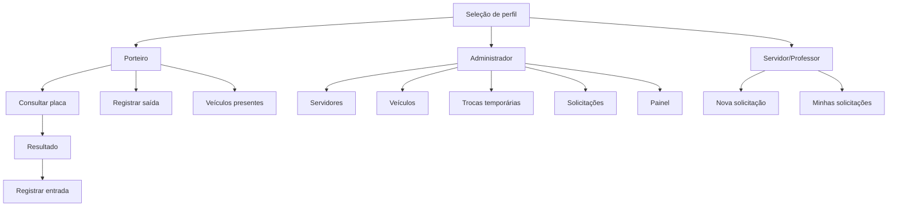

# Protótipo das telas

**SPG - SmartPark Guarita**
Versão 0.1: rascunho em baixa fidelidade, a refinar com a equipe e depois da entrevista.

Os desenhos abaixo mostram a organização de cada tela. Os dados são fictícios. O protótipo refinado deve ser feito em uma ferramenta de desenho (por exemplo Figma ou papel e foto) e referenciado nas histórias de usuário.

## 1. Fluxo de navegação



## 2. Seleção de perfil

```
+--------------------------------------+
|        SmartPark Guarita             |
|                                      |
|     Escolha o seu perfil             |
|                                      |
|   [        Porteiro              ]   |
|   [        Administrador         ]   |
|   [        Servidor/Professor    ]   |
|                                      |
+--------------------------------------+
```

## 3. Porteiro: consultar placa

```
+--------------------------------------+
| < Porteiro                           |
|                                      |
|  Placa                               |
|  [ BRA2E19                        ]  |
|                                      |
|  [          Consultar             ]  |
|                                      |
|  +--------------------------------+  |
|  |  AUTORIZADO                    |  |
|  |  Troca temporária do professor |  |
|  |  Válida até 23h59 de hoje      |  |
|  +--------------------------------+  |
|                                      |
|  [ Registrar entrada ]               |
+--------------------------------------+
```

Resultados possíveis: "Autorizado" (verde), "Autorizado por troca temporária" (verde, com validade), "Não autorizado" (vermelho).

## 4. Porteiro: registrar saída e veículos presentes

```
+--------------------------------------+       +--------------------------------------+
| < Registrar saída                    |       | < Veículos presentes (3)             |
|                                      |       |                                      |
|  Placa                               |       |  BRA2E19  Onix prata    08:12        |
|  [ ABC1D23                        ]  |       |  ABC1D23  Gol branco    08:40        |
|                                      |       |  XYZ9K88  Civic preto   09:05        |
|  [        Registrar saída         ]  |       |                                      |
+--------------------------------------+       +--------------------------------------+
```

## 5. Administrador: menu e cadastros

```
+--------------------------------------+       +--------------------------------------+
| Administrador                        |       | < Novo servidor                      |
|                                      |       |                                      |
|  [ Servidores              ]         |       |  Nome        [                    ]  |
|  [ Veículos                ]         |       |  Matrícula   [                    ]  |
|  [ Trocas temporárias      ]         |       |                                      |
|  [ Solicitações (2)        ]         |       |  [ Cancelar ]        [ Salvar ]      |
|  [ Painel                  ]         |       |                                      |
+--------------------------------------+       +--------------------------------------+
```

Os campos do cadastro dependem das respostas 6 e 7 da entrevista.

```
+--------------------------------------+       +--------------------------------------+
| < Novo veículo                       |       | < Nova troca temporária              |
|                                      |       |                                      |
|  Servidor    [ Selecionar        v ] |       |  Servidor   [ Selecionar        v ]  |
|  Placa       [                    ]  |       |  Placa      [                    ]   |
|  Modelo      [                    ]  |       |  Modelo     [                    ]   |
|  Cor         [                    ]  |       |  Cor        [                    ]   |
|                                      |       |  Motivo     [                    ]   |
|  [ Cancelar ]        [ Salvar ]      |       |  Início     [ dd/mm/aaaa hh:mm   ]   |
|                                      |       |  Fim        [ dd/mm/aaaa hh:mm   ]   |
|                                      |       |  [ Cancelar ]        [ Salvar ]      |
+--------------------------------------+       +--------------------------------------+
```

## 6. Administrador: solicitações

```
+--------------------------------------+
| < Solicitações pendentes             |
|                                      |
|  Prof. Exemplo Silva                 |
|  BRA2E19, Onix prata                 |
|  Motivo: carro da esposa             |
|  Hoje, até 23h59                     |
|  [ Recusar ]          [ Aprovar ]    |
|  ------------------------------------|
|  Servidor Teste Souza                |
|  ...                                 |
+--------------------------------------+
```

## 7. Servidor/Professor

```
+--------------------------------------+       +--------------------------------------+
| Servidor/Professor                   |       | < Minhas solicitações                |
|                                      |       |                                      |
|  [ Nova solicitação        ]         |       |  BRA2E19   Hoje      APROVADA        |
|  [ Minhas solicitações     ]         |       |  DEF4G56   03/12     PENDENTE        |
|                                      |       |  GHI7J89   01/12     RECUSADA        |
+--------------------------------------+       +--------------------------------------+

+--------------------------------------+
| < Nova solicitação                   |
|                                      |
|  Placa       [                    ]  |
|  Modelo      [                    ]  |
|  Cor         [                    ]  |
|  Motivo      [                    ]  |
|  Período     [ início ] [ fim ]      |
|                                      |
|  [ Cancelar ]        [ Enviar ]      |
+--------------------------------------+
```

## 8. Painel

```
+--------------------------------------+
| < Painel                             |
|                                      |
|  Ocupação atual                      |
|  3 veículos no estacionamento        |
|                                      |
|  Entradas e saídas por turno         |
|  Manhã   entradas 12   saídas  4     |
|  Tarde   entradas  7   saídas  9     |
|  Noite   entradas  1   saídas  3     |
+--------------------------------------+
```

Os horários de cada turno serão confirmados na entrevista (pergunta 11).

## 9. Referências por história

| Tela | Histórias |
|---|---|
| Seleção de perfil | todas |
| Consultar placa | US01, US02 |
| Registrar saída | US03 |
| Veículos presentes | US04 |
| Novo servidor | US05 |
| Novo veículo | US06 |
| Nova troca temporária | US07 |
| Solicitações pendentes | US08 |
| Nova solicitação | US09 |
| Minhas solicitações | US10 |
| Painel | US11, US12 |
